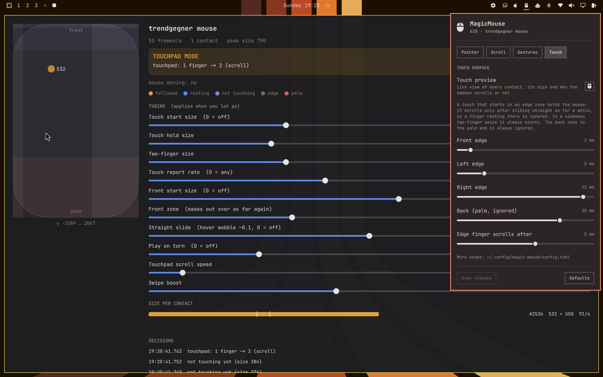

# MagicMouse for Omarchy

Make an Apple Magic Mouse feel like it does on a Mac, on [Omarchy](https://omarchy.org)
(Hyprland, Wayland). Scrolling that glides like on a trackpad, a workspace that follows
your two fingers and lets you change your mind halfway, no scrolling while your finger only
hovers, and a pointer that slows down for small targets the way macOS does.



It will never be a Mac. But on our two mice (a Magic Mouse 1 and a Magic Mouse 2) it now
feels about **98% like one**: scrolling glides and stops and turns on the spot, a light
two-finger swipe moves the workspace, and a hovering finger no longer flickers. Our Magic
Mouse 2 even keeps a text selection while dragging, which it no longer did on the Mac.
Every setting is there to get you closer on your own mouse and your own hand.

### The breakthrough: the mouse knows when a finger touches

For two days we tuned size thresholds, front zones, a wobble rule and a little play
against one problem: a finger hovering a millimetre above the mouse looks like a light
touch, and scrolling flickered. Then a recording of the mouse's raw Bluetooth reports
showed what we had been missing. For every contact the mouse sends its own **contact
state**: hovering, landing, touching, lifting, lingering. These are the states macOS works
with. Linux's `hid_magicmouse` driver reads that byte but passes on only "a contact is
there", for every state, so a hovering finger reached us as a touch.

The driver has a switch, `report_undeciphered`, that hands the byte on as it is. The
installer sets it, and the daemon now counts a finger exactly while the mouse says it
touches. No kernel patch. The size rules stay as the fallback when the switch is off.

## What it does

A small daemon grabs the mouse and turns its touch surface into something Linux
understands well:

- **Touchpad mode (default).** The mouse also acts as a trackpad, with one finger more:
  one finger on the mouse is two on the virtual trackpad, so apps scroll pixel by pixel and
  glide on by themselves, exactly as they do for a real trackpad. Two fingers sideways are
  three on the trackpad: Hyprland's live workspace swipe, which follows your fingers and
  goes back if you change your mind. The mouse is small, so a swipe counts your finger
  travel several times (**Swipe boost**, 2.7×).
  As on a Mac, a scroll stays one scroll: a finger that rests or lands beside it is ignored,
  up and down any number of fingers scroll as one, and only two fingers going sideways
  together are the swipe. Small, gentle scrolls of a line or two count, and a short flick
  counts from its very start.
- **Touch check.** The surface already reports a finger 1-2 mm above it. With the mouse's
  own contact state (see above) a finger counts exactly while the mouse says it touches,
  however light, and two touching fingers side by side going sideways are the workspace
  swipe at once, edge zones or not, from where they landed. Without it a finger only
  counts once it really touches: big enough, and reporting at the rate of a real touch
  (a hovering finger reports less often). Once it counts, it keeps counting while it gets
  lighter as it slides. Two fingers together need less, since one of them usually comes
  in from the side. A report with no width is a finger hovering over the edge and never
  counts. Near the front, where the finger lies flatter and a hover looks as big as a light
  touch, a single finger needs a bigger start size. In touchpad mode a finger that wobbles
  on the spot instead of sliding one way stays up, and a finger already down has a little
  play: a wobble within it scrolls nothing back and forth, a slide runs on without a jerk.
- **Fingers that only hold the mouse don't count.** Touches that land in an edge zone
  hold the mouse: they scroll only after sliding straight on for a few millimetres, so a
  finger resting or wobbling there is ignored, while in a sideways two-finger swipe they
  always count. The back of the surface is where your palm rests and is ignored. Each
  zone is adjustable per side, so you can leave as wide or as narrow a scroll area in
  the middle as you like.
- **Pointer.** Apple's own acceleration curve (from the open-source IOHIDFamily driver),
  driven by the same "Tracking speed" number as the macOS slider, with smoothing so
  Bluetooth bursts can't make the cursor jump. A click briefly freezes the pointer so the
  click itself can't nudge it.
- **Clicks.** Left and right are decided by the mouse's own firmware, as on macOS; the
  kernel's centre "middle click" zone (paste on Linux) is a left click. Control + click as
  a right click is a switch.
- **Workspaces at the ends.** In touchpad mode Hyprland's swipe decides (with the
  [Trackpad plugin](https://github.com/2strange/omarchy-trackpad): stop or open a new one,
  empty workspaces count). Without touchpad mode the daemon switches by itself: stop, open a
  new one, or wrap around, and empty workspaces count, so you can always reach a workspace
  to start something on.
- **Without touchpad mode** the daemon scrolls by itself: start threshold, natural or wheel
  direction, diagonal scrolling, momentum, one-finger page flick and a two-finger
  workspace switch. Useful on a compositor without trackpad gestures.
- **Several mice at once.** Every connected Magic Mouse is driven, all with the same
  settings (as on a Mac). The menu lists each with its charge.
- **In the bar:** the mouse's charge and name, amber when low and red when critical
  (the emptiest mouse decides); click for the settings, right-click for Bluetooth.
- **Battery in Bluetooth settings.** BlueZ knows no battery for a classic Bluetooth mouse.
  The daemon reports it (BlueZ's battery provider API), so the charge shows next to the
  mouse in Omarchy's Bluetooth panel and anywhere else.

## The touch preview

Open **Touch preview** in the menu (Touch tab). It shows what the mouse reports, live:
every contact with its size and report rate, which ones are followed, resting, not
touching yet, on an edge or the palm, the edge zones, and the reason for every decision
("not touching yet (size 210)", "touchpad: 2 fingers -> 3 (swipe)", …).

A lamp shows whether the mouse's own contact state reaches the daemon (green), or that
the mouse has to be turned off and on once to pick up the driver switch (amber), and each
contact shows its state (touching, hovering, …).

Its sliders set the touch check (start size, hold size, two-finger size, report rate,
front zone, straight slide, play on turn; the size sliders hide while the mouse's own
state decides)
while you watch your own fingers, so you can tune the mouse to your hand in a minute.
Sizes are the mouse's own scale (0 to about 1000). It runs from a terminal too:

```sh
qs -p ~/.config/omarchy/plugins/io.github.2strange.magicmouse/preview
```

The stream is a private Unix socket (`$XDG_RUNTIME_DIR/magic-mouse/probe.sock`, owner
only). Nothing is sent while no preview is connected; `--no-probe` turns it off.

## Requirements

- Omarchy 4 with Hyprland 0.56 or newer (Lua config).
- `python-evdev` (the installer adds it) and the in-kernel `hid_magicmouse` driver.
- `python-gobject` for the battery in Bluetooth settings (on Omarchy already there, the
  installer adds it otherwise; without it that one feature is off).
- **For the workspace swipe in touchpad mode,** Hyprland needs a three-finger workspace
  gesture. Omarchy ships it commented out in `~/.config/hypr/input.lua`; remove the `--`
  in front of

  ```lua
  hl.gesture({ fingers = 3, direction = "horizontal", action = "workspace" })
  ```

  or use the [Trackpad plugin](https://github.com/2strange/omarchy-trackpad), which adds it
  and also sets what happens at the last workspace and whether empty ones count. Both your
  trackpad and the mouse use that one gesture.

## Install

```sh
# 1. the plugin: the bar widget and its menu
omarchy plugin add https://github.com/2strange/omarchy-magicmouse --enable

# 2. the daemon, its user service, a udev rule and a driver option (asks for your password once)
~/.config/omarchy/plugins/io.github.2strange.magicmouse/install.sh
```

Pair the mouse over Bluetooth as usual; the daemon waits for it and takes it over whenever
it connects. **After the first install, turn each mouse off and on once**: the driver reads
its new options only when a mouse connects (the preview's lamp tells you). Updates: `omarchy plugin update io.github.2strange.magicmouse`, then re-run
`install.sh` to refresh the daemon.

```sh
systemctl --user status magic-mouse        # is it running?
journalctl --user -u magic-mouse -f        # what is it doing?
```

**Coming from `maikunari/omarchy-magic-mouse`?** Same daemon name, service and
`~/.config/magic-mouse/config.toml`, so your settings carry over. Install as above;
`install.sh` disables the old bar widget, then `omarchy plugin remove
io.github.maikunari.magic-mouse` removes it. Touchpad mode is on by default; switch it off
on the Scroll tab to keep the daemon's own scrolling.

## Settings

Click the mouse in the bar. Every switch applies at once, sliders when you let go;
**Undo changes** returns to how things were when the menu opened, **Defaults** resets
the open tab.

| Tab | Settings |
|---|---|
| Pointer | tracking speed, right-side click, Control-click, battery percentage in the bar |
| Scroll | touchpad mode, natural scrolling, scroll speed; without touchpad mode also start distance, diagonal scrolling, momentum |
| Gestures | workspace swipe on/off, swipe direction reversed against the trackpad, swipe boost; without touchpad mode page flick, two-finger workspace switch, swipe distance, end of row, empty workspaces, direction |
| Touch | touch preview, edge zones front / left / right, palm zone at the back, how far an edge finger slides before it scrolls |

Everything lives in `~/.config/magic-mouse/config.toml` (commented, changes apply live).
`magic-mouse-config set touchpad.swipe_gain=3` edits it from a shell without touching your
comments, `magic-mouse-config get` prints the effective settings.

| Feels like… | Change |
|---|---|
| scrolls while the finger only hovers | is the preview's lamp green? If not, turn the mouse off and on. Without the mouse's state: raise the start size or the report rate |
| flickers, tiny scrolls to and fro while a finger hovers close | raise Straight slide or Play on turn; near the front: Front start size |
| a light touch does not scroll | lower the start size; a scroll that stops while sliding: lower the hold size |
| two-finger swipe hard to start | lower the two-finger size, raise Swipe boost |
| touchpad scrolling too fast / slow | Scroll speed on the Scroll tab (`touchpad.scroll_speed`) |
| pointer too slow / fast | Tracking speed, same scale as macOS (0 to 3, Apple default 0.6875) |
| a finger holding the mouse scrolls | widen the edge zone on that side, or raise "Edge finger scrolls after" |
| the palm scrolls | raise the back zone |

## Tested on

- **Magic Mouse 1** (`05ac:030d`, AA batteries) and **Magic Mouse 2** (`004c:0269`), alone
  and both at once, on a MacBook Pro 11,3, Omarchy 4.0.6, Hyprland 0.56.2. Both send the
  contact state. The Magic Mouse 2 feels a little crisper, as it does on the Mac.
- Magic Mouse USB-C (`004c:0323`) is recognised by ID but not tested yet. Reports welcome.

## Limits

- No pinch, no smart zoom, no Mission Control: the hooks for one- and two-finger double
  tap can run any command, they are off by default.
- In touchpad mode the trackpad settings that Hyprland applies to every touchpad (the
  three-finger gesture, end of row, empty workspaces) are shared with your built-in
  trackpad. Scroll speed, natural scrolling, the swipe on/off and its direction (same as
  the trackpad or reversed) are set for the mouse alone.
- The mouse is smaller than a trackpad: a full-hand swipe as on a Magic Trackpad does not
  fit, hence the swipe boost.
- Two fingers that really slide while the hand holds the mouse can move the workspace, and
  now and then switch it. Widen the edge zones if that happens to you.
- "Empty workspaces count" means 1-5 plus every one up to the highest open one, as in the
  bar. With several monitors that is counted per monitor.
- The first-generation mouse does not answer the daemon's direct battery query; the
  daemon then takes the kernel's reading, which works.
- A very light, very quick swipe (well under 100 ms) is sometimes missed; about 8 in 10
  register, about as on the Mac.

## Remove

```sh
~/.config/omarchy/plugins/io.github.2strange.magicmouse/uninstall.sh   # daemon, service, udev rule, driver option
omarchy plugin remove io.github.2strange.magicmouse                     # the bar widget
```

`~/.config/magic-mouse/config.toml` and the small `magic-mouse-omarchy` device block in
your Hyprland input config stay; delete them by hand for a clean slate.

## What the installer touches

| Path | What |
|---|---|
| `~/.local/bin/magic-mouse-daemon`, `magic-mouse-config`, `magic-mouse-battery-query` | the daemon and its two helpers |
| `~/.config/systemd/user/magic-mouse.service` | user service, enabled and started |
| `~/.config/magic-mouse/config.toml` | your settings (only created if missing) |
| `~/.config/hypr/input.lua` (or `input.conf`) | a 7-line device block, **appended only after asking**, with a backup |
| `/etc/udev/rules.d/70-magic-mouse.rules` | a `uaccess` rule for the mouse's input and raw HID nodes and for `/dev/uinput`, matched by device ID |
| `/etc/modprobe.d/hid_magicmouse.conf` | `emulate_3button=0 report_undeciphered=1` (also set at once for the running driver) |
| `/etc/modules-load.d/magic-mouse.conf` | loads `uinput` at boot so the rule above can apply |

No file from the checkout runs as root. The only privileged step is a short Python helper
embedded in `install.sh` and handed to the distro's `python3` on the command line, so it
is in memory before `sudo` runs. It carries the exact bytes of the three `/etc` files,
walks to each directory without following symlinks, writes to an exclusive temporary file,
verifies it, renames it into place atomically and prints SHA-256 digests that `install.sh`
re-checks as your user. No group changes, no sudoers entries, nothing downloaded at
install time. The daemon runs as your user and talks only to the mouse, `/dev/uinput`
and Hyprland's socket.

More detail on the file handling: `config.toml` and the status file are read and written
descriptor-first (no symlink following, no blocking on a FIFO, owner/type/size checks,
`O_EXCL` temp file and rename); the bar widget reads the battery status through a
short-lived child (`status-reader.py`) under `timeout`, never inside the shell.

## Development

```sh
/usr/bin/python3 -m unittest discover -s tests -v
```

The tests drive the daemon's engine with synthetic touch frames (touch tracking, touch
check, the mouse's contact state, touchpad mode and the swipe pair, workspace ends).

## Credits

MagicMouse grew out of [omarchy-magic-mouse](https://github.com/maikunari/omarchy-magic-mouse)
by Mike Sewell, which brought Apple's pointer curve, the click handling, the battery query
and the careful installer. Thank you. This plugin reworked touch tracking, scrolling and
gestures around the question "does it feel like the Mac?" and added touchpad mode, the
touch check, edge and palm zones, the touch preview and the tabbed menu, and found the
mouse's own contact state that the Linux driver keeps to itself. It is a separate
plugin with its own ID, so both can be found and installed on their own.

Built by the Omarchy Bob team for [2strange](https://github.com/2strange).

## License

MIT, see [LICENSE](LICENSE).

Magic Mouse, Mac and macOS are trademarks of Apple Inc. This project is independent and is
not affiliated with or endorsed by Apple.
